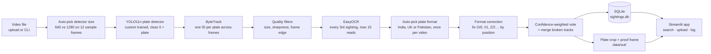

# PlateTrace: number-plate search for traffic video

Type a number plate and find out whether that vehicle passed the camera, **when** it passed, and see the **proof frame**.

PlateTrace is an ANPR (Automatic Number Plate Recognition) demo. It takes ordinary traffic footage, finds every number plate in it, reads the text, and saves each vehicle in a searchable database. You use it through a Streamlit web app: upload a video, wait for processing, then search by plate.

---

## 1. Idea and use case

**The problem.** Someone has hours of CCTV or dash-cam footage and one question: *did vehicle `GX15OGJ` pass this camera, and when?* Answering that by scrubbing through video by hand is slow and easy to get wrong.

**The idea.** Process each video once, offline, and turn it into a small table of *who passed and when*. After that, every question is an instant text search instead of watching video.

**Example uses**
- **Security and incident review:** check whether a reported vehicle entered a site or road during a time window.
- **Parking and gate logs:** build an automatic entry log from a gate camera.
- **Traffic studies:** count distinct vehicles in a clip and see when each one appeared.
- **Evidence:** each result comes with the plate crop, an annotated proof frame, and a video player that opens at the moment the car appears.

**What a search returns**

| Result | Meaning |
|---|---|
| ✔ **VEHICLE PASSED** | Exact match on the plate text |
| ≈ **POSSIBLE MATCH (xx%)** | Close match (≥ 75% text similarity), which covers OCR misreading a character |
| **NO RECORD FOUND** | The plate was not seen in any processed video |

---

## 2. Architecture



### Pipeline, step by step

1. **Detector size check.** The detector runs on 12 frames spread through the video at both 640px and 1280px. Whichever size finds more confident plates (confidence ≥ 0.5) is used for the whole video. Close-up footage works best at 640; wide shots with small, distant plates need 1280.
2. **Detection.** A YOLO11n model fine-tuned on our own labelled frames finds plate bounding boxes. Only class `0 = plate` is used; class `1 = vehicle` is ignored.
3. **Tracking.** ByteTrack gives each plate a stable ID across frames, so one car = one track, not hundreds of separate detections.
4. **Quality filters.** A crop is skipped if it is narrower than 40px, blurry (Laplacian variance < 40), or touching the frame edge (half-visible plates give misleading reads).
5. **OCR.** EasyOCR reads every 3rd usable sighting of a track, up to 15 reads per track (OCR is the slowest step on CPU). Small crops are enlarged 2–3× in greyscale first. Text pieces are joined left to right, so two-part plates are read as one.
6. **Plate format detection.** All raw reads from the video are tested against the India, UK and Pakistan layouts. The layout that most reads fit cleanly is chosen *once for the whole video*. Choosing per read let UK patterns wrongly win on Indian plates.
7. **Format correction.** Each read is snapped onto the chosen layout. Letter/digit look-alikes are fixed by position (`O↔0`, `I↔1`, `Z↔2`, `S↔5`, `B↔8`, `G↔6`…), and junk such as the `IND`/`GB` strip is dropped. Reads needing more than 3 fixes are rejected, which removes most non-plate text.
8. **Voting.** Each track's reads are combined by a confidence-weighted vote. The winning text becomes the plate, and its share of the vote becomes the confidence.
9. **Track merging.** If the tracker loses a plate and gives it a new ID, two tracks less than 2 s apart with ≥ 70% similar text are merged back into one vehicle.
10. **Storage.** One row per vehicle goes into SQLite. The largest plate crop and its annotated frame are saved as JPGs. Processing a video again replaces its old rows.

### Supported plate formats

| Region | Layout (`A` = letter, `9` = digit) | Example |
|---|---|---|
| India `IN` | `AA 9(9) A(AA) 9999` | `DL7CD5017`, `HR26CO6869` |
| UK `UK` | `AA99 AAA` (current style) | `GX15OGJ` |
| Pakistan `PK` | `AA(A) 999(9)`, older Punjab `AAA 99 9999` | `LEA1234`, `KAD404`, `LEB071234` |
| Off | no correction, raw OCR text | |

To add another country, add its layouts to the `FORMATS` dict in `process.py`.

### Database schema (`data/out/sightings.db`, table `sightings`)

| Column | Type | Description |
|---|---|---|
| `video` | TEXT | Video name (file name without extension) |
| `track_id` | INT | ByteTrack ID |
| `plate` | TEXT | Final voted plate text |
| `conf` | REAL | Vote share of the winning text (0–1) |
| `first_s`, `last_s` | REAL | First and last time seen, in seconds |
| `crop` | TEXT | Path to the best plate crop |
| `frame` | TEXT | Path to the annotated proof frame |
| `video_path` | TEXT | Path to the source video (used for playback) |

---

## 3. Tech stack

| Layer | Tool | Version |
|---|---|---|
| Language | Python | 3.11 |
| Detection + training | Ultralytics YOLO11 | 8.4.215 |
| Deep learning backend | PyTorch (CPU) | 2.15.0 |
| Tracking | ByteTrack (built into Ultralytics) | |
| OCR | EasyOCR (English, CPU) | 1.7.2 |
| Video and image processing | OpenCV | 5.1 |
| Storage | SQLite | stdlib |
| Data handling | pandas | 3.1.1 |
| Web UI | Streamlit | 1.67.0 |
| Labelling | Roboflow | |
| Fuzzy search | `difflib.SequenceMatcher` | stdlib |

Everything runs on **CPU**; no GPU is required.

---

## 4. Model

### Plate detector: `models/plate.pt`

| Item | Value |
|---|---|
| Base model | `yolo11n.pt` (YOLO11 nano, COCO-pretrained) |
| Classes | `0: plate`, `1: vehicle` |
| Dataset | 22 frames from `testvideo.mp4`, labelled in Roboflow, exported in YOLO format |
| Split | 21 train / 1 test (used as validation) |
| Preprocessing | Auto-orient, resize to 512×512 (stretch); no augmentation in Roboflow |
| Epochs | 150 |
| Image size | 512 |
| Batch | 16 |
| Optimizer | AdamW (auto-selected), lr0 ≈ 0.00167 |
| Device | CPU |
| Final metrics | precision 0.967 · recall 1.0 · mAP50 0.995 · mAP50-95 0.995 |

> **Note:** the metrics above come from a **single validation image**, so they show the model learned its training data, not how well it generalises. The real test is the videos below.

### OCR

EasyOCR's pretrained English model with no fine-tuning, restricted to `A–Z 0–9 -`.

---

## 5. Parameters

All parameters are at the top of [process.py](process.py). Most can also be changed from the command line or the app's *Settings* panel.

| Parameter | Default | What it does |
|---|---|---|
| `IMGSZ` | `"auto"` | Detector input size; auto picks from `IMGSZ_CHOICES = (640, 1280)` |
| `CONF` | `0.3` | Minimum detector confidence for a plate box |
| `VID_STRIDE` | `1` | Process every Nth frame (2 ≈ 2× faster) |
| `PLATE_REGION` | `"auto"` | `"auto"`, `"IN"`, `"UK"`, or `None` (no correction) |
| `MIN_WIDTH` | `40` px | Skip plate crops narrower than this |
| `MIN_SHARPNESS` | `40.0` | Skip blurry crops (Laplacian variance) |
| `EDGE` | `3` px | Skip plates touching the frame border |
| `OCR_EVERY` | `3` | OCR every Nth usable sighting of a track |
| `MAX_READS` | `15` | Stop OCR on a track after this many reads |
| `MAX_FIXES` | `3` | Max letter/digit corrections allowed when snapping to a format |
| `MERGE_GAP_S` | `2.0` s | Max time gap for merging two tracks into one car |
| `MERGE_SIMILARITY` | `0.7` | Min text similarity for merging tracks |
| `PLATE_PATTERN` | `None` | Optional extra regex filter for plate text |
| Tracker | `bytetrack.yaml` | Ultralytics default ByteTrack config |
| Search threshold | `0.75` | Similarity for "possible match" (in `app.py`) |
| Upload limit | `2000` MB | `.streamlit/config.toml` → `server.maxUploadSize` |

---

## 6. Results

| Video | Footage | Auto settings chosen | Result |
|---|---|---|---|
| `testvideo.mp4` | 1080p, 30 fps, 11 s, Indian plates, close-up | India · 640px | **4 / 4 plates read exactly** (`DL7CD5017`, `DL3CBJ1384`, `DL2CAT4762`, `HR26CO6869`) |
| `testvideo1.mp4` | 720p, 30 fps, 31 s, UK motorway, small distant plates | UK · 1280px | **16 vehicles**; several read exactly (e.g. `GX15OGJ`, `PJ14ZHY`), many off by 1–2 characters, 1 false hit on a van's "DRAINAGE" sign |

**Before the improvements**, `testvideo1` gave only 1 result, a false positive. The detector was trained at 512px and ran at 640, which missed the small plates, and every read was forced into the Indian format, so correct UK reads were thrown away. Automatic detector size and plate-format detection fixed both without retraining.

**Processing time on CPU:** about 2 minutes for a 30 s clip at 640px, about 5 minutes at 1280px. Every 2nd frame roughly halves this.

---

## 7. The web app

`streamlit run app.py` opens a dark-themed app with three tabs:

- **🔎 Search:** type a plate (spaces and dashes are ignored). You get the verdict, the plate crop, the annotated proof frame, time seen, read confidence, and a video player that starts at the moment the car appears.
- **⬆️ Upload video:** upload `mp4 / mov / avi / mkv / m4v / webm` and click **Process video**. A live progress bar runs, and the plates become searchable straight away. *Settings* lets you override plate format, detector size and speed. Uploading a video with the same name again replaces its old results. A summary table lists each processed video and its plates.
- **📋 All detections:** the full log with confidence bars, filterable by video.

The sidebar shows how many videos have been processed and how many vehicles were detected.

---

## 8. How to run

```powershell
python -m venv .venv; .venv\Scripts\activate
pip install -r requirements.txt

# Web app: upload and search (the easiest way)
streamlit run app.py

# Or process videos from the command line
python process.py data/videos/testvideo.mp4 data/videos/testvideo1.mp4
python process.py VIDEO --region UK --imgsz 1280 --conf 0.3 --stride 2   # manual overrides
```

### Retraining the detector (optional)

```powershell
python extract_frames.py data/videos/myvideo.mp4 --fps 2   # frames -> data/frames_to_label/
# label "plate" (and optionally "vehicle") in Roboflow, export as YOLOv11 into data/train, data/test
python train.py --epochs 150 --imgsz 512                   # -> models/plate.pt (copied from best.pt)
```

`data/plates.yaml` points training at `data/train/images` and validates on `data/test/images`.

---

## 9. Project structure

```
anpr-demo/
├── app.py               Streamlit UI: search, upload and process, detection log
├── process.py           Pipeline: detect → track → OCR → format fix → vote → SQLite
├── train.py             Fine-tune YOLO11 on labelled plates → models/plate.pt
├── extract_frames.py    Dump video frames for labelling
├── requirements.txt
├── yolo11n.pt           Pretrained base weights
├── models/plate.pt      Trained plate detector
├── .streamlit/config.toml   Theme + 2 GB upload limit
└── data/
    ├── videos/          Source and uploaded videos
    ├── train/ test/     Roboflow-exported YOLO dataset
    ├── plates.yaml      Training config
    ├── frames_to_label/ Extracted frames
    └── out/             sightings.db, crops/, frames/
```

---

## 10. Limitations and next steps

- **Small training set.** The detector has seen 22 frames from one Indian video. Labelling frames from the UK video (already extracted in `data/frames_to_label/`) and retraining should cut misreads and false hits like the van sign.
- **OCR on small plates.** EasyOCR struggles with plates under ~60px wide. Options: a plate-specific OCR model (e.g. fast-plate-ocr or PaddleOCR), or super-resolution on crops.
- **Formats.** Indian, UK and Pakistani layouts are supported; older UK styles and other countries need entries in `FORMATS`.
- **Speed.** It is CPU only. A GPU, or `--stride 2`, makes processing much faster.
- **Playback.** Only H.264 `.mp4` plays in the browser; other formats are still processed and searchable.
- **No real-time mode.** Videos are processed after upload; there is no live camera stream yet.
